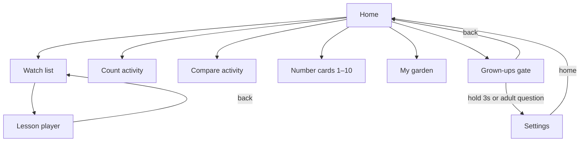
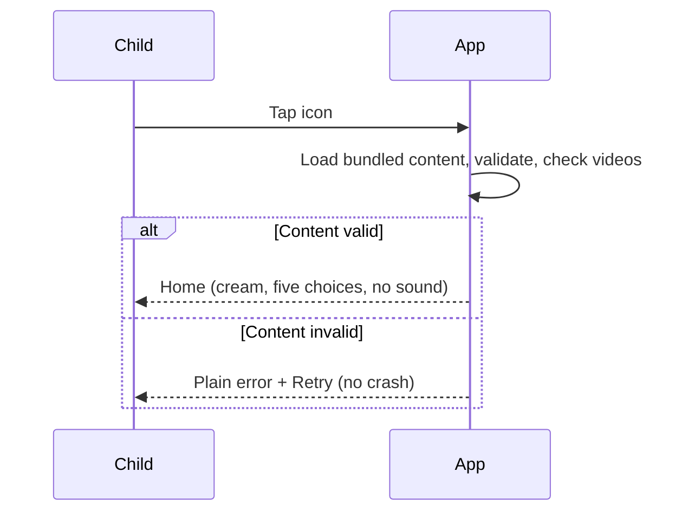
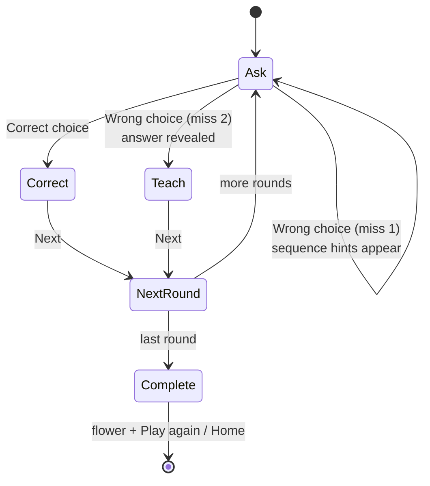
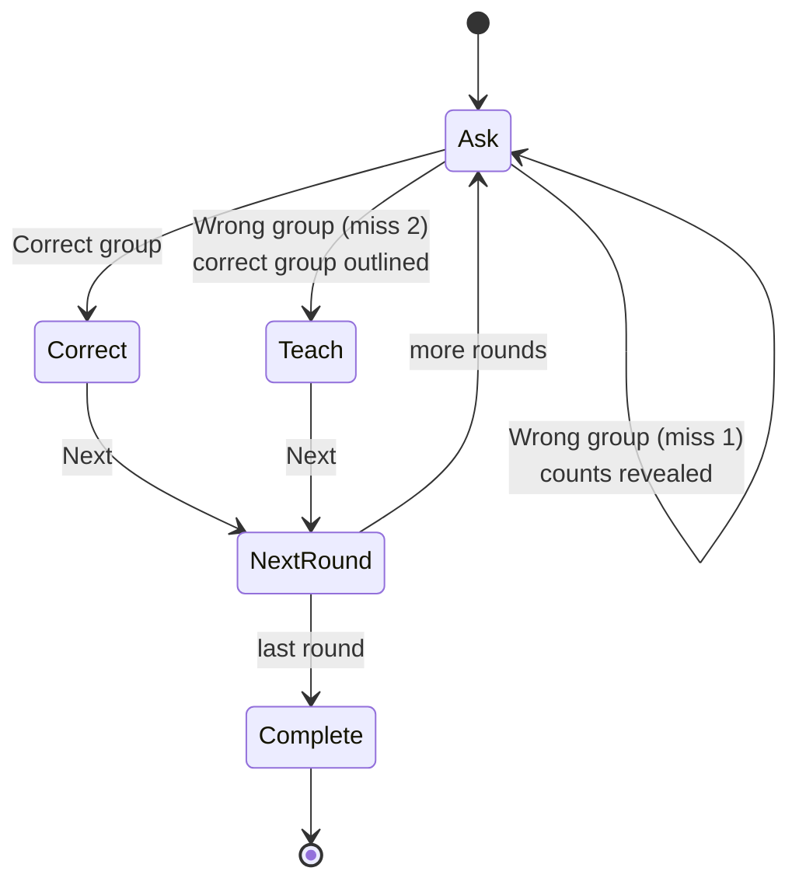
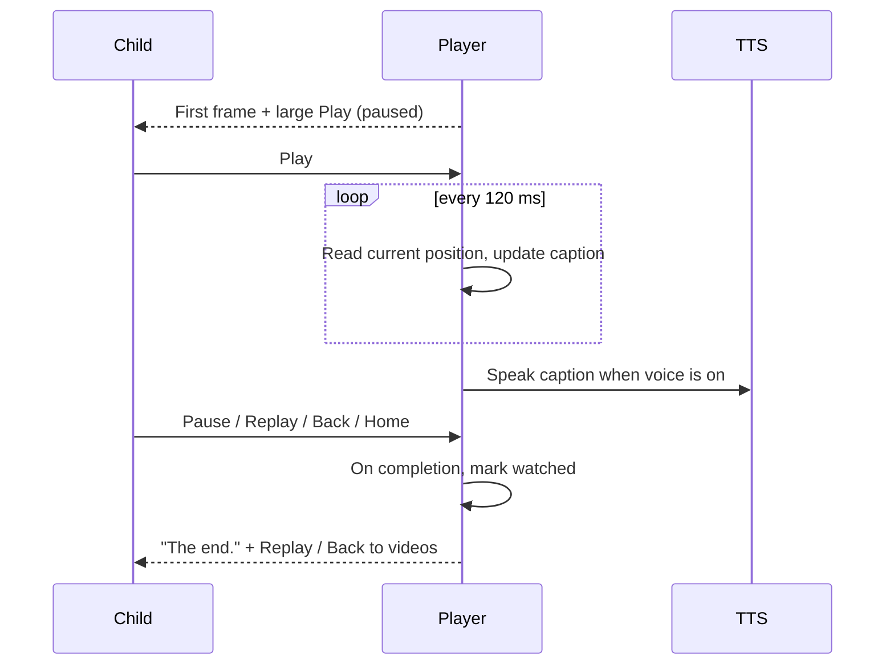
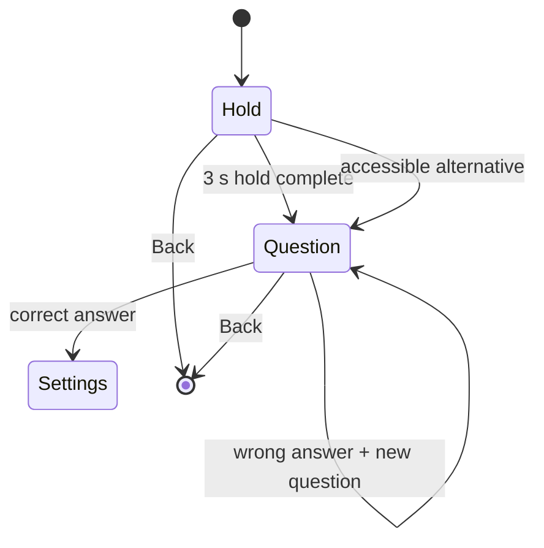

# Screen map and flows

## Screen map

All child screens share the same top bar. The left control is Home (or Back on the lesson
list), and it is never hidden. The nav host uses no screen transitions, so navigation is an
instant, predictable cut.

## First launch

No onboarding wizard. No permission prompt. No account. The caregiver is expected to review
settings first, but the child can start immediately.

## Counting loop

- One flower is recorded when the final Next/Finish is tapped, not on the last correct tap.
- The session is deterministic per launch but shuffled between launches; the visual frame
  never changes.
- Leaving at any state discards the in-progress session without penalty.

## Compare loop

Prompt alternates *more* and *fewer* according to the authored content pack, not randomly
within a round. Equal groups are rejected by the content validator.

## Video lesson

- Video is copied to cache on first play to avoid asset-path quirks in some players.
- Sound off mutes the video; voice off suppresses TTS. Captions remain.
- Backgrounding pauses playback and stops speech.
- No autoplay, no looping, no next-lesson chain.

## Garden

Home → My garden. Plots fill left-to-right, top-to-bottom, one per completed session. There
is no animation that draws attention repeatedly. At 12 flowers the heading becomes “Your
garden is full. You can still play.”

## Parental gate

The gate is friction, not security. There are no purchases or external links behind it. An
adult using TalkBack can choose the question alternative with a normal double-tap.

## Settings

Settings → toggle voice / sound / reduce motion / high contrast; choose 3 or 5 rounds;
reset progress (confirm); read privacy/about. Changes save immediately. Home returns to the
start.

## Error, empty, and edge states

| State | Behaviour |
| --- | --- |
| Content missing/invalid | Full-screen plain message + Retry + Home; no crash |
| Individual video missing | “This video is not ready.” inside player; other screens still work |
| No lessons | “No videos yet.” in Watch |
| Garden empty | “Your garden is waiting.” |
| Garden full | “Your garden is full. You can still play.” |
| Voice/TTS unavailable | Silent fallback; all captions remain |
| Rotation/process death | No crash; in-progress activity may restart; progress already saved survives |
| App backgrounded during video | Video pauses, speech stops, screen-on flag cleared |
| Back during a round | Returns to previous screen; no confirmation, no loss beyond the round |
| Rapid repeated taps | Ignored after a choice locks; no double flower |

## Layout adaptations

- Phone portrait: single column, all screens scroll.
- Phone landscape/tablet: same single column capped at readable width; content scrolls
  rather than stretching. No side-by-side layout in the MVP.
- 200% font scale: text wraps; rows that hold numerals use three equal columns; settings
  and cards grow vertically.
- Cutouts and gesture bars: root screens use safe-drawing insets.
